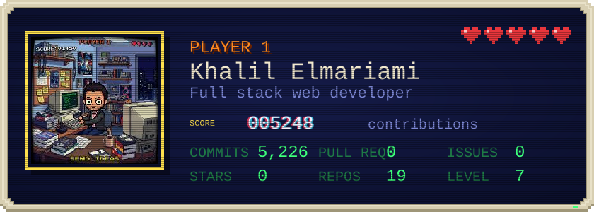
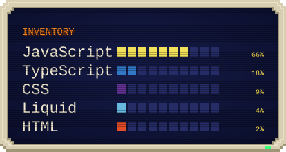
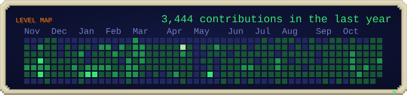

  

  

  
  
  

I'm a **Full Stack Web Developer** who loves turning complex problems into intuitive, scalable, and fast web applications. From pixel-perfect frontends to robust backends and APIs, I enjoy every layer of the stack — and I care about the details that make products feel great to use.

- 🔭 Building modern, responsive, and accessible web apps
- 🌱 Currently diving into **Deep Learning**, **Serverless Architectures**, and **Web Performance Optimization**
- 🎨 Also into **UI/UX** and graphic design
- ⚡ Fun fact: I love puzzles, algorithms, and traveling — it fuels my creativity

**Frontend**

**Backend**

**Databases**

**DevOps & Cloud**

**Testing**

| | |
|---|---|
| 🚀 **End-to-End Development** | Take ideas from concept to production |
| 🎨 **Modern Interfaces** | Responsive, accessible, and polished UIs |
| ⚙️ **Scalable Backends** | Well-structured APIs and backend systems built to grow |
| 🔌 **Integrations** | Third-party APIs and services that extend functionality |
| 🧹 **Clean Code** | Readable, efficient, maintainable, and well-tested |

  
  

  

### 🤖 [SocialAI Manager](https://github.com/elmariamikhalil/Social-manager) — AI-Powered Content & Marketing Manager

An all-in-one tool for creating, scheduling and publishing social media content, with AI doing the heavy lifting.

- ✍️ AI content studio and marketing plans powered by Google Gemini
- 📈 Trend tracking from RSS feeds to suggest timely post ideas
- 🖼️ Branded post graphics generated automatically through Cloudinary transformations
- ⏰ Background scheduler (node-cron) for the publish queue, trend refreshes and growth snapshots
- 🔗 Social account connections and publishing through the Meta API
- 📊 Analytics dashboards and a posts library with platform previews
- ⚡ Live updates over Socket.io

       

 

### 🎓 [MyDev](https://github.com/elmariamikhalil/MyDev) — Learning Platform with Paths, Mentors & Certificates

A full learning platform built in TypeScript end to end, with separate experiences for students, mentors and admins.

- 🧭 Learning paths with progression locking, auto-enrollment and "next course" flow
- 📝 Rich Markdown lessons, quizzes and tasks inside a course player
- 🏅 Course and path certificates on completion
- 👩‍🏫 Mentor dashboard, mentor directory and an inbox for messages
- 🛠️ Admin panel for users, courses and paths
- ☁️ Avatar and image uploads to AWS S3, deployed on EC2

       

 

### 🎧 [Spotify Clone](https://github.com/elmariamikhalil/spotify-clone) — Music Streaming Platform

A music streaming app with three roles: listeners, artists and admins.

- 🎵 Playlists, liked songs, library, search and listening history
- 💡 Recommendations, followers and artist profiles
- 🎤 Artist dashboard for uploading songs and managing albums
- 🛡️ Admin dashboard and data export
- ☁️ Audio and cover storage on Azure Blob Storage and Cloudinary
- 🔐 JWT auth, bcrypt hashing and API rate limiting

       

 

### 🧩 More projects

| Project | What it is |
|---|---|
| 🏦 [MT940 Converter](https://github.com/elmariamikhalil/mt940) | Converts MT940 bank statements (and Apple Numbers files) into clean CSV/Excel, with a stats dashboard |
| 📚 [Academy](https://github.com/elmariamikhalil/Academy2) | Online academy with video and text lessons, enrollments, progress tracking, evaluations and reports, on a MySQL/Sequelize backend |

  

Open to collaborations, freelance work, and interesting conversations.

